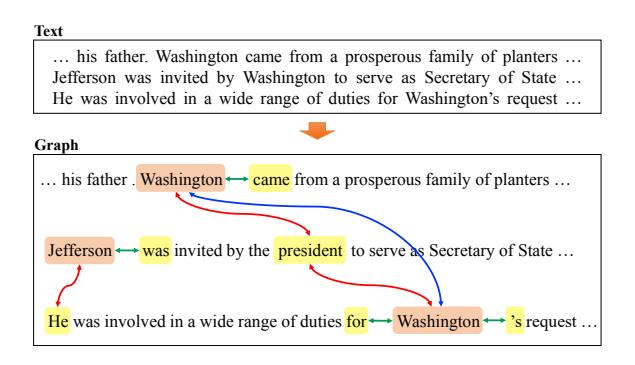
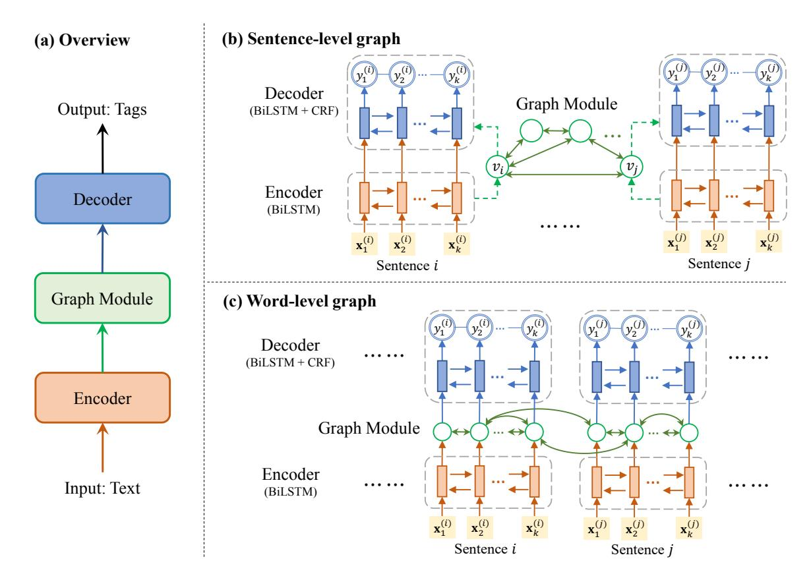
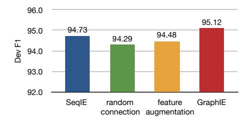
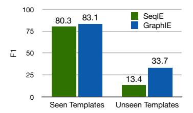
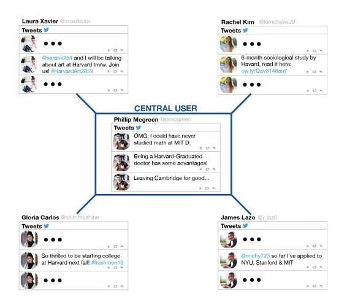
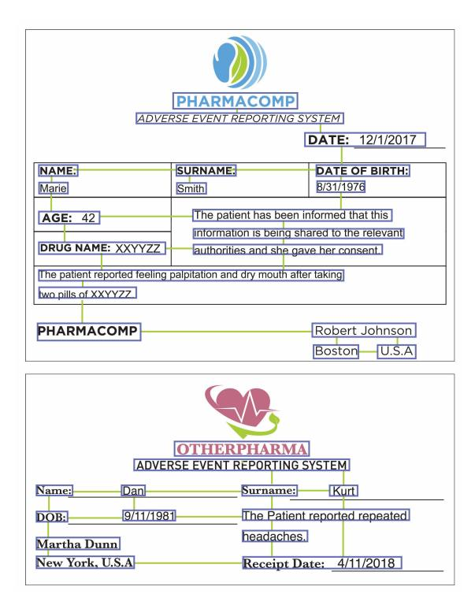

# GraphIE: A Graph-Based Framework for Information Extraction

Yujie Qian1 , Enrico Santus1 , Zhijing Jin2 , Jiang Guo1 , and Regina Barzilay1

1Computer Science and Artificial Intelligence Laboratory, MIT 2Department of Computer Science, The University of Hong Kong

[{yujieq,jiang\\_guo,regina}@csail.mit.edu,{esantus,zhijing}@mit.edu]({yujieq,jiang_guo,regina}@csail.mit.edu, {esantus,zhijing}@mit.edu)

## Abstract

Most modern Information Extraction (IE) systems are implemented as sequential taggers and only model local dependencies. Non-local and non-sequential context is, however, a valuable source of information to improve predictions. In this paper, we introduce GraphIE, a framework that operates over a graph representing a broad set of dependencies between textual units (i.e. words or sentences). The algorithm propagates information between connected nodes through graph convolutions, generating a richer representation that can be exploited to improve word-level predictions. Evaluation on three different tasks — namely textual, social media and visual information extraction — shows that GraphIE consistently outperforms the state-of-the-art sequence tagging model by a significant margin.[1](#page-0-0)

# 1 Introduction

Most modern Information Extraction (IE) systems are implemented as sequential taggers. While such models effectively capture relations in the local context, they have limited capability of exploiting non-local and non-sequential dependencies. In many applications, however, such dependencies can greatly reduce tagging ambiguity, thereby improving overall extraction performance. For instance, when extracting entities from a document, various types of non-local contextual information such as co-references and identical mentions may provide valuable cues. See for example Figure [1,](#page-0-1) in which the non-local relations are crucial to discriminate the entity type of the second mention of *Washington* (i.e. PERSON, ORGANIZATION or LOCATION).

Most of the prior work looking at the non-local dependencies incorporates them by constraining

Figure 1: Example of the entity extraction task with an ambiguous entity mention (i.e. "...for Washington's request..."). Aside from the sentential forward and backward edges (green) which aggregate local contextual information, non-local relations — such as the co-referent edges (red) and the identical-mention edges (blue) — provide additional valuable information to reduce tagging ambiguity (i.e. PERSON, ORGANIZA-TION or LOCATION).

the output space in a structured prediction framework [\(Finkel et al.,](#page-9-0) [2005;](#page-9-0) [Reichart and Barzilay,](#page-9-1) [2012;](#page-9-1) [Hu et al.,](#page-9-2) [2016\)](#page-9-2). Such approaches, however, mostly overlook the richer set of structural relations in the input space. With reference to the example in Figure [1,](#page-0-1) the co-referent dependencies would not be readily exploited by simply constraining the output space, as they would not necessarily be labeled as entities (e.g. pronouns). In the attempt to capture non-local dependencies in the input space, alternative approaches define a graph that outlines the input structure and engineer features to describe it [\(Quirk and Poon,](#page-9-3) [2017\)](#page-9-3). Designing effective features is however challenging, arbitrary and time consuming, especially when the underlying structure is complex. Moreover, these approaches have limited capacity of capturing node interactions informed by the graph structure.

In this paper, we propose GraphIE, a framework

1Our code and data are available at [https://github.](https://github.com/thomas0809/GraphIE) [com/thomas0809/GraphIE](https://github.com/thomas0809/GraphIE).

that improves predictions by automatically learning the interactions between local and non-local dependencies in the input space. Our approach integrates a graph module with the encoder-decoder architecture for sequence tagging. The algorithm operates over a graph, where nodes correspond to textual units (i.e. words or sentences) and edges describe their relations. At the core of our model, a recurrent neural network sequentially encodes local contextual representations and then the graph module iteratively propagates information between neighboring nodes using graph convolutions [\(Kipf and Welling,](#page-9-4) [2016\)](#page-9-4). The learned representations are finally projected back to a recurrent decoder to support tagging at the word level.

We evaluate GraphIE on three IE tasks, namely textual, social media, and visual [\(Aumann et al.,](#page-9-5) [2006\)](#page-9-5) information extraction. For each task, we provide in input a simple task-specific graph, which defines the data structure without access to any major processing or external resources. Our model is expected to learn from the relevant dependencies to identify and extract the appropriate information. Experimental results on multiple benchmark datasets show that GraphIE consistently outperforms a strong and commonly adopted sequential model (SeqIE, i.e. a bidirectional long-short term memory (BiLSTM) followed by a conditional random fields (CRF) module). Specifically, in the textual IE task, we obtain an improvement of 0.5% over SeqIE on the CONLL03 dataset, and an improvement of 1.4% on the chemical entity extraction [\(Krallinger et al.,](#page-9-6) [2015\)](#page-9-6). In the social media IE task, GraphIE improves over SeqIE by 3.7% in extracting the EDU-CATION attribute from twitter users. In visual IE, finally, we outperform the baseline by 1.2%.

## 2 Related Work

The problem of incorporating non-local and nonsequential context to improve information extraction has been extensively studied in the literature. The majority of methods have focused on enforcing constraints in the output space during inference, through various mechanisms such as posterior regularization or generalized expectations [\(Finkel et al.,](#page-9-0) [2005;](#page-9-0) [Mann and McCallum,](#page-9-7) [2010;](#page-9-7) [Reichart and Barzilay,](#page-9-1) [2012;](#page-9-1) [Li et al.,](#page-9-8) [2013;](#page-9-8) [Hu](#page-9-2) [et al.,](#page-9-2) [2016\)](#page-9-2).

Research capturing non-local dependencies in the input space have mostly relied on featurebased approaches. [Roberts et al.](#page-9-9) [\(2008\)](#page-9-9) and [Swampillai and Stevenson](#page-10-0) [\(2011\)](#page-10-0) have designed intra- and inter-sentential features based on discourse and syntactic dependencies (e.g., shortest paths) to improve relation extraction. [Quirk](#page-9-3) [and Poon](#page-9-3) [\(2017\)](#page-9-3) used document graphs to flexibly represent multiple types of relations between words (e.g., syntactic, adjacency and discourse relations).

Graph-based representations can be also learned with neural networks. The most related work to ours is the graph convolutional network by [Kipf](#page-9-4) [and Welling](#page-9-4) [\(2016\)](#page-9-4), which was developed to encode graph structures and perform node classification. In our framework, we adapt GCN as an intermediate module that learns non-local context, which — instead of being used directly for classification — is projected to the decoder to enrich local information and perform sequence tagging.

A handful of other information extraction approaches have used graph-based neural networks. [Miwa and Bansal](#page-9-10) [\(2016\)](#page-9-10) applied Tree LSTM [\(Tai](#page-10-1) [et al.,](#page-10-1) [2015\)](#page-10-1) to jointly represent sequences and dependency trees for entity and relation extraction. On the same line of work, [Peng et al.](#page-9-11) [\(2017\)](#page-9-11) and [Song et al.](#page-10-2) [\(2018\)](#page-10-2) introduced Graph LSTM, which extended the traditional LSTM to graphs by enabling a varied number of incoming edges at each memory cell. [Zhang et al.](#page-10-3) [\(2018\)](#page-10-3) exploited graph convolutions to pool information over pruned dependency trees, outperforming existing sequence and dependency-based neural models in a relation extraction task. These studies differ from ours in several respects. First, they can only model wordlevel graphs, whereas our framework can learn non-local context either from word- or sentencelevel graphs, using it to reduce ambiguity during tagging at the word level. Second, all these studies achieved improvements only when using dependency trees. We extend the graph-based approach to validate the benefits of using other types of relations in a broader range of tasks, such as coreference in named entity recognition, *followed-by* link in social media, and layout structure in visual information extraction.

# 3 Problem Definition

We formalize information extraction as a sequence tagging problem. Rather than simply modeling inputs as sequences, we assume there exists a graph structure in the data that can be exploited to cap-

Figure 2: GraphIE framework: (a) an overview of the framework; (b) architecture for *sentence-level graph*, where each sentence is encoded to a node vector and fed into the graph module, and the output of the graph module is used as the initial state of the decoder; (c) architecture for *word-level graph*, where the hidden state for each word of the encoder is taken as the input node vector of the graph module, and then the output is fed into the decoder.

ture non-local and non-sequential dependencies between textual units, namely words or sentences.

We consider the input to be a set of sentences  $S = \{s_1, \ldots, s_N\}$  and an auxiliary graph G = (V, E), where  $V = \{v_1, \ldots, v_M\}$  is the node set and  $E \subset V \times V$  is the edge set. Each sentence is a sequence of words. We consider two different designs of the graph:

- (1) sentence-level graph, where each node is a sentence (i.e. M=N), and the edges encode sentence dependencies;
- (2) word-level graph, where each node is a word (i.e. *M* is the number of words in the input), and the edges connect pairs of words, such as co-referent tokens.

The edges  $e_{i,j}=(v_i,v_j)$  in the graph can be either directed or undirected. Multiple edge types can also be defined to capture different structural factors underlying the task-specific input data.

We use the BIO (Begin, Inside, Outside) tagging scheme in this paper. For each sentence

$$s_i = (w_1^{(i)}, w_2^{(i)}, \dots, w_k^{(i)}),^2$$
 we sequentially tag each word as  $\mathbf{y}_i = (y_1^{(i)}, y_2^{(i)}, \dots, y_k^{(i)}).$ 

#### 4 Method

GraphIE jointly learns local and non-local dependencies by iteratively propagating information between node representations. Our model has three components:

- an encoder, which generates local contextaware hidden representations for the textual unit (i.e. word or sentence, depending on the task) with a recurrent neural network;
- a graph module, which captures the graph structure, learning non-local and nonsequential dependencies between textual units:
- a *decoder*, which exploits the contextual information generated by the graph module to perform labelling at the word level.

 $^2$ While sentences may have different lengths, for notation simplicity we use a single variable k.

Figure 2 illustrates the overview of GraphIE and the model architectures for both sentence- and word-level graphs. In the following sections, we first introduce the case of the sentence-level graph, and then we explain how to adapt the model for the word-level graph.

#### 4.1 Encoder

In GraphIE, we first use an encoder to generate text representations. Given a sentence  $s_i = (w_1^{(i)}, w_2^{(i)}, \dots, w_k^{(i)})$  of length k, each word  $w_t^{(i)}$  is represented by a vector  $\mathbf{x}_t^{(i)}$ , which is the concatenation of its word embedding and a feature vector learned with a character-level convolutional neural network (CharCNN; Kim et al. (2016)). We encode the sentence with a recurrent neural network (RNN), defining it as

$$\mathbf{h}_{1:k}^{(i)} = \mathtt{RNN}\left(\mathbf{x}_{1:k}^{(i)}; \mathbf{0}, \Theta_{\mathrm{enc}}\right), \tag{1}$$

where  $\mathbf{x}_{1:k}^{(i)}$  denotes the input sequence  $[\mathbf{x}_1^{(i)},\cdots,\mathbf{x}_k^{(i)}]$ ,  $\mathbf{h}_{1:k}^{(i)}$  denotes the hidden states  $[\mathbf{h}_1^{(i)},\cdots,\mathbf{h}_k^{(i)}]$ ,  $\mathbf{0}$  indicates the initial hidden state is zero, and  $\Theta_{\mathrm{enc}}$  represents the encoder parameters. We implement the RNN as a bi-directional LSTM (Hochreiter and Schmidhuber, 1997), and encode each sentence independently.

We obtain the sentence representation for  $s_i$  by averaging the hidden states of its words, i.e.  $\mathrm{Enc}(s_i) = \frac{1}{k} \left( \sum_{t=1}^k \mathbf{h}_t^{(i)} \right)$ . The sentence representations are then fed into the graph module.

### 4.2 Graph Module

The graph module is designed to learn the non-local and non-sequential information from the graph. We adapt the graph convolutional network (GCN) to model the graph context for information extraction.

Given the sentence-level graph G=(V,E), where each node  $v_i$  (i.e. sentence  $s_i$ ) has the encoding  $\mathrm{Enc}(s_i)$  capturing its local information, the graph module enriches such representation with neighbor information derived from the graph structure.

Our graph module is a GCN which takes as input the sentence representation, i.e.  $\mathbf{g}_i^{(0)} = \text{Enc}(s_i)$ , and conducts graph convolution on every node, propagating information between its neighbors, and integrating such information into a new hidden representation. Specifically, each layer of

GCN has two parts. The first gets the information of each node from the previous layer, i.e.

$$\boldsymbol{\alpha}_i^{(l)} = \mathbf{W}_v^{(l)} \mathbf{g}_i^{(l-1)}, \tag{2}$$

where  $\mathbf{W}_{v}^{(l)}$  is the weight to be learned. The second aggregates information from the neighbors of each node, i.e. for node  $v_{i}$ , we have

$$\boldsymbol{\beta}_i^{(l)} = \frac{1}{d(v_i)} \cdot \mathbf{W}_e^{(l)} \left( \sum_{e_{i,j} \in E} \mathbf{g}_j^{(l-1)} \right), \quad (3)$$

where  $d(v_i)$  is the degree of node  $v_i$  (i.e. the number of edges connected to  $v_i$ ) and is used to normalize  $\beta_i^{(l)}$ , ensuring that nodes with different degrees have representations of the same scale.3 In the simplest case, where the edges in the graph are undirected and have the same type, we use the same weight  $\mathbf{W}_e^{(l)}$  for all of them. In a more general case, where multiple edge types exist, we expect them to have different impacts on the aggregation. Thus, we model these edge types with different weights in Eq. 3, similar to the relational GCN proposed by Schlichtkrull et al. (2018). When edges are directed, i.e. edge  $e_{i,j}$ is different from  $e_{i,i}$ , the propagation mechanism should mirror such difference. In this case, we consider directed edges as two types of edges (forward and backward), and use different weights for

Finally,  $\alpha_i^{(l)}$  and  $\beta_i^{(l)}$  are combined to obtain the representation at the l-th layer,

$$\mathbf{g}_i^{(l)} = \sigma \left( \boldsymbol{\alpha}_i^{(l)} + \boldsymbol{\beta}_i^{(l)} + b^{(l)} \right), \tag{4}$$

where  $\sigma(\cdot)$  is the non-linear activation function, and  $b^{(l)}$  is a bias parameter.

Because each layer only propagates information between directly connected nodes, we can stack multiple graph convolutional layers to get a larger receptive field, i.e. each node can be aware of more distant neighbors. After L layers, for each node  $v_i$  we obtain a contextual representation,  $GCN(s_i) = \mathbf{g}_i^{(L)}$ , that captures both local and non-local information.

#### 4.3 Decoder

To support tagging, the learned representation is propagated to the decoder.

&lt;sup>3We choose this simple normalization strategy instead of the two-sided normalization in Kipf and Welling (2016), as it performs better in the experiments. The same strategy is also adopted by Zhang et al. (2018).

In our work, the decoder is instantiated as a BiLSTM+CRF tagger (Lample et al., 2016). The output representation of the graph module,  $GCN(s_i)$ , is split into two vectors of the same length, which are used as the initial hidden states for the forward and backward LSTMs, respectively. In this way, the graph contextual information is propagated to each word through the LSTM. Specifically, we have

$$\mathbf{z}_{1:k}^{(i)} = \mathtt{RNN}\left(\mathbf{h}_{1:k}^{(i)}; \mathtt{GCN}(s_i), \Theta_{\mathrm{dec}}\right), \quad (5)$$

where  $\mathbf{h}_{1:k}^{(i)}$  are the output hidden states of the encoder,  $\text{GCN}(s_i)$  represents the initial state, and  $\Theta_{\text{dec}}$  is the decoder parameters. A simpler way to incorporate the graph representation into the decoder is concatenating with its input, but the empirical performance is worse than using as the initial state.

Finally, we use a CRF layer (Lafferty et al., 2001) on top of the BiLSTM to perform tagging,

$$\mathbf{y}_{i}^{*} = \arg\max_{\mathbf{y} \in \mathbf{Y}_{k}} p\left(\mathbf{y} \mid \mathbf{z}_{1:k}^{(i)}; \Theta_{\text{crf}}\right), \quad (6)$$

where  $\mathbf{Y}_k$  is the set of all possible tag sequences of length k, and  $\Theta_{\mathrm{crf}}$  represents the CRF parameters, i.e. transition scores of tags. CRF combines the local predictions of BiLSTM and the transition scores to model the joint probability of the tag sequence.4

### 4.4 Adaptation to Word-level Graphs

GraphIE can be easily adapted to model word-level graphs. In such case, the nodes represent words in the input, i.e. the number of nodes M equals the total number of words in the N sentences. At this point, each word's hidden state in the encoder can be used as the input node vector  $\mathbf{g}_i^{(0)}$  of the graph module. GCN can then conduct graph convolution on the word-level graph and generate graph-contextualized representations for the words. Finally, the decoder directly operates on the GCN's outputs, i.e. we change the BiLSTM decoder to

$$\mathbf{z}_{1:k}^{(i)} = \mathtt{RNN}\left(\left[\mathtt{GCN}(w_1^{(i)}), \cdots, \mathtt{GCN}(w_k^{(i)})\right]; \mathbf{0}, \Theta_{\mathrm{dec}}\right),$$

where  $\mathrm{GCN}(w_t^{(i)})$  is the GCN output for word  $w_t^{(i)}$ . In this case, the BiLSTM initial states are set to the default zero vectors. The CRF layer remains unchanged.

As it can be seen in Figure 2(c), the word-level graph module differs from the sentence-level one because it directly takes the word representations from the encoder and feeds its output to the decoder. In sentence-level graph, the GCN operates on sentence representations, which are then used as the initial states of the decoder BiLSTM.

#### 5 Experimental Setup

We evaluate the model on three tasks, including two traditional IE tasks, namely textual information extraction and social media information extraction, and an under-explored task — *visual information extraction*. For each of these tasks, we created a simple task-specific graph topology, designed to easily capture the underlying structure of the input data without any major processing. Table 1 summarizes the three tasks.

#### 5.1 Task 1: Textual Information Extraction

In this task, we focus on named entity recognition at discourse level (DiscNER). In contrast to traditional sentence-level NER (SentNER), where sentences are processed independently, in DiscNER, long-range dependencies and constraints across sentences have a crucial role in the tagging process. For instance, multiple mentions of the same entity are expected to be tagged consistently in the same discourse. Here we propose to use this (soft) constraint to improve entity extraction.

**Dataset** We conduct experiments on two NER datasets: the CoNLL-2003 dataset (CoNLL03) (Tjong et al., 2003), and the CHEMDNER dataset for chemical entity extraction (Krallinger et al., 2015). We follow the standard split of each corpora. Statistics are shown in Table 2.

**Graph Construction** In this task, we use a word-level graph where nodes represent words. We create two types of edges for each document:

- Local edges: forward and backward edges are created between neighboring words in each sentence, allowing local contextual information to be utilized.
- Non-local edges: re-occurrences of the same token other than stop words are connected, so

&lt;sup>4In GraphIE, the graph module models the input space structure, i.e. the dependencies between textual units (i.e. sentences or words), and the final CRF layer models the sequential connections of the output tags. Even though loops may exist in the input graph, CRF operates sequentially, thus the inference is tractable.

| Evaluation Task | Graph Type     | Node          | Edge                                                                                      |
|-----------------|----------------|---------------|-------------------------------------------------------------------------------------------|
| Textual IE      | word-level     | word          | 1. non-local consistency (identical mentions) 2. local sentential forward and backward |
| Social Media IE | sentence-level | user's tweets | followed-by                                                                               |
| Visual IE       | sentence-level | text box      | spatial layout (horizontal and vertical)                                                  |

Table 1: Comparisons of graph structure in the three IE tasks used for evaluation.

| DATASET  |       | Train  | Dev    | Test   |
|----------|-------|--------|--------|--------|
| CONLL03  | #doc  | 946    | 216    | 231    |
|          | #sent | 14,987 | 3,466  | 3,684  |
| CHEMDNER | #doc  | 3,500  | 3,500  | 3,000  |
|          | #sent | 30,739 | 30,796 | 26,399 |

Table 2: Statistics of the CONLL03 and the CHEMD-NER datasets (Task 1).

that information can be propagated through, encouraging global consistency of tagging.[5](#page-5-2)

# 5.2 Task 2: Social Media Information Extraction

Social media information extraction refers to the task of extracting information from users' posts in online social networks [\(Benson et al.,](#page-9-16) [2011;](#page-9-16) [Li](#page-9-17) [et al.,](#page-9-17) [2014\)](#page-9-17). In this paper, we aim at extracting *education* and *job* information from users' tweets. Given a set of tweets posted by a user, the goal is to extract mentions of the organizations to which they belong. The fact that the tweets are short, highly contextualized and show special linguistic features makes this task particularly challenging.

Dataset We construct two datasets, EDUCA-TION and JOB, from the Twitter corpus released by [Li et al.](#page-9-17) [\(2014\)](#page-9-17). The original corpus contains millions of tweets generated by ≈ 10 thousand users, where the *education* and *job* mentions are annotated using distant supervision [\(Mintz et al.,](#page-9-18) [2009\)](#page-9-18). We sample the tweets from each user, maintaining the ratio between positive and negative posts.[6](#page-5-3) The obtained EDUCATION dataset consists of 443, 476 tweets generated by 7, 208 users, and the JOB dataset contains 176, 043 tweets generated by 1, 772 users. Dataset statistics are reported in Table [3.](#page-5-4)

|                 | EDUCATION | JOB     |
|-----------------|-----------|---------|
| Users           | 7,208     | 1,772   |
| Edges           | 11,167    | 3,498   |
| Positive Tweets | 49,793    | 3,694   |
| Negative Tweets | 393,683   | 172,349 |

Table 3: Statistics of the EDUCATION and JOB datasets (Task 2).

The datasets are both split in 60% for training, 20% for development, and 20% for testing. We perform 5 different random splits and report the average results.

Graph Construction We construct the graph as *ego-networks* [\(Leskovec and Mcauley,](#page-9-19) [2012\)](#page-9-19), i.e. when we extract information about one user, we consider the subgraph formed by the user and his/her direct neighbors. Each node corresponds to a Twitter user, who is represented by the set of posted tweets.[7](#page-5-5) Edges are defined by the *followedby* link, under the assumption that connected users are more likely to come from the same university or company. An example of the social media graph is reported in the appendices.

# 5.3 Task 3: Visual Information Extraction

Visual information extraction refers to the extraction of attribute values from documents formatted in various layouts. Examples include invoices and forms, whose format can be exploited to infer valuable information to support extraction.

Dataset The corpus consists of 25,200 Adverse Event Case Reports (AECR) recording drugrelated side effects. Each case contains an average of 9 pages. Since these documents are produced by multiple organizations, they exhibit large variability in the layout and presentation styles (e.g.

5Note that other non-local relations such as co-references (cf. the example in Figure [1\)](#page-0-1) may be used for further improvement. However, these relations require additional resources to obtain, and we leave them to future work.

6 Positive and negative refer here to whether or not the *education* or *job* mention is present in the tweet.

7As each node is a set of tweets posted by the user, we encode every tweet with the encoder, and then average them to obtain the node representation. In the decoding phase, the graph module's output is fed to the decoder for each tweet.

text, table, etc.).[8](#page-6-0) The collection is provided with a separate human-extracted ground truth database that is used as a source of distant supervision.

Our goal is to extract eight attributes related to the patient, the event, the drug and the reporter (cf. Table [6](#page-8-0) for the full list). Attribute types include dates, words and phrases — which can be directly extracted from the document.

The dataset is split in 50% cases for training, 10% for development, and 40% for testing.

Graph Construction We first turn the PDFs to text using PDFMiner,[9](#page-6-1) which provides words along with their positions in the page (i.e. bounding-box coordinates). Consecutive words are then geometrically joined into *text boxes*. Each text box is considered as a "sentence" in this task, and corresponds to a *node* in the graph.

Since the page layout is the major structural factor in these documents, we work on page-by-page basis, i.e. each page corresponds to a graph. The *edges* are defined to horizontally or vertically connect *nodes* (text boxes) that are close to each other (i.e. when the overlap of their bounding boxes, in either the vertical or horizontal direction, is over 50%). Four types of edge are considered: left-toright, right-to-left, up-to-down, and down-to-up. When multiple nodes are aligned, only the closest ones are connected. An example of visual document graph is reported in the appendices.

# 5.4 Baseline and Our Method

We implement a two-layer BiLSTM with a conditional random fields (CRF) tagger as the sequential baseline (SeqIE). This architecture and its variants have been extensively studied and demonstrated to be successful in previous work on information extraction [\(Lample et al.,](#page-9-14) [2016;](#page-9-14) [Ma and Hovy,](#page-9-20) [2016\)](#page-9-20). In the textual IE task (Task 1), our baseline is shown to obtain competitive results with the state-of-the-art method in the CONLL03 dataset. In the visual IE task (Task 3), in order to further increase the competitiveness of the baseline, we sequentially concatenate the horizontally aligned text boxes, therefore fully modeling the horizontal edges of the graph.

Our baseline shares the same encoder and decoder architecture with GraphIE, but without the graph module. Both architectures have similar

| DATASET  | Model                                                                                | F1                                         |
|----------|--------------------------------------------------------------------------------------|--------------------------------------------|
| CONLL03  | Lample et al. (2016) Ma and Hovy (2016) Ye and Ling (2018) SeqIE GraphIE | 90.94 91.21 91.38 91.16 91.74∗ |
| CHEMDNER | Krallinger et al. (2015) SeqIE GraphIE                                         | 87.39 88.28 89.71∗                   |

Table 4: NER accuracy on the CONLL03 and the CHEMDNER datasets (Task 1). Scores for our methods are the average of 5 runs. \* indicates statistical significance of the improvement over SeqIE (p < 0.01).

computational cost. In Task 1, we apply GraphIE with word-level graph module (cf. Figure [2\(](#page-2-1)c)), and in Task 2 and Task 3, we apply GraphIE with sentence-level graph module (cf. Figure [2\(](#page-2-1)b)).

### 5.5 Implementation Details

The models are trained with Adam [\(Kingma and](#page-9-21) [Ba,](#page-9-21) [2014\)](#page-9-21) to minimize the CRF objective. For regularization, we choose dropout with a ratio of 0.1 on both the input word representation and the hidden layer of the decoder. The learning rate is set to 0.001. We use the development set for early-stopping and the selection of the best performing hyperparameters. For CharCNN, we use 64-dimensional character embeddings and 64 filters of width 2 to 4 [\(Kim et al.,](#page-9-12) [2016\)](#page-9-12). The 100 dimensional pretrained GloVe word embeddings [\(Pennington et al.,](#page-9-22) [2014\)](#page-9-22) are used in Task 1 and 2, and 64-dimensional randomly initialized word embeddings are used in Task 3. We use a twolayer GCN in Task 1, and a one-layer GCN in Task 2 and Task 3. The encoder and decoder BiLSTMs have the same dimension as the graph convolution layer. In Task 3, we concatenate a positional encoding to each text box's representation by transforming its bounding box coordinates to a vector of length 32, and then applying a tanh activation.

# 6 Results

### 6.1 Task 1: Textual Information Extraction

Table [4](#page-6-2) describes the NER accuracy on the CONLL03 [\(Tjong et al.,](#page-10-5) [2003\)](#page-10-5) and the CHEMD-NER [\(Krallinger et al.,](#page-9-6) [2015\)](#page-9-6) datasets.

For CONLL03, we list the performance of existing approaches. Our baseline SeqIE obtains competitive scores compared to the best methods. The fact that GraphIE significantly outperforms

8This dataset cannot be shared for patient privacy and proprietary issues.

9<https://euske.github.io/pdfminer/>

| DATASET          | Dictionary   |              | SeqIE        |              |              | GraphIE      |              |              |               |
|------------------|--------------|--------------|--------------|--------------|--------------|--------------|--------------|--------------|---------------|
|                  | P            | R            | F1           | P            | R            | F1           | P            | R            | F1            |
| EDUCATION JOB | 78.7 55.7 | 93.5 70.2 | 85.4 62.1 | 85.2 66.2 | 93.6 66.7 | 89.2 66.2 | 92.9 67.1 | 92.8 66.1 | 92.9∗ 66.5 |

Table 5: Extraction accuracy on the EDUCATION and JOB datasets (Task 2). Dictionary is a naive method which creates a dictionary of entities from the training set and extracts their mentions during testing time. Scores are the average of 5 runs. \* indicates the improvement over SeqIE is statistically significant (Welch's t-test, p < 0.01).

Figure 3: Analysis on the CONLL03 dataset. We compare with two alternative designs: (1) *random connection*, where we replace the constructed graph by a random graph with the same number of edges; (2) *feature augmentation*, where we use the average embedding of each node and its neighbors as the input to the decoder, instead of the GCN which has additional parameters. We report F1 scores on the development set.

it, highlights once more the importance of modeling non-local and non-sequential dependencies and confirms that our approach is an appropriate method to achieve this goal.[10](#page-7-0)

For CHEMDNER, we show the best performance reported in [Krallinger et al.](#page-9-6) [\(2015\)](#page-9-6), obtained with a feature-based method. Our baseline outperforms the feature-based method, and GraphIE further improves the performance by 1.4%.

Analysis To understand the advantage of GraphIE, we first investigate the importance of graph structure to the model. As shown in Figure [3,](#page-7-1) using random connections clearly hurts the performance, bringing down the F1 score of GraphIE from 95.12% to 94.29%. It indicates that the task-specific graph structures introduce beneficial inductive bias. Trivial feature augmentation also does not work well, confirming the necessity of learning the graph embedding with GCN.

We further conduct error analysis on the test set to validate our motivation that GraphIE resolves tagging ambiguity by encouraging consistency among identical entity mentions (cf. Figure [1\)](#page-0-1). Here we examine the word-level tagging accuracy. We define the words that have more than one possible tags in the dataset as *ambiguous*. We find that among the 1.78% tagging errors of SeqIE, 1.16% are *ambiguous* and 0.62% are *unambiguous*. GraphIE reduces the error rate to 1.67%, with 1.06% to be *ambiguous* and 0.61% *unambiguous*. We can see that most of the error reduction indeed attributes to the *ambiguous* words.

# 6.2 Task 2: Social Media Information Extraction

Table [5](#page-7-2) shows the results for the social media information extraction task. We first report a simple dictionary-based method as a baseline. Neural IE models achieve much better performance, showing that meaningful patterns are learned by the models rather than simply remembering the entities in the training set. The proposed GraphIE outperforms SeqIE in both the EDUCATION and JOB datasets, and the improvements are more significant for the EDUCATION dataset (3.7% versus 0.3%). The reason for such difference is the variance in the affinity scores [\(Mislove et al.,](#page-9-25) [2010\)](#page-9-25) between the two datasets. [Li et al.](#page-9-17) [\(2014\)](#page-9-17) underline that affinity value for EDUCATION is 74.3 while for JOB it is only 14.5, which means that in the datasets neighbors are 5 times more likely to have studied in the same university than worked in the same company. We can therefore expect that a model like GraphIE, which exploits neighbors' information, obtains larger advantages in a dataset characterized by higher affinity.

### 6.3 Task 3: Visual Information Extraction

Table [6](#page-8-0) shows the results in the visual information extraction task. GraphIE outperforms the SeqIE baseline in most attributes, and achieves 1.2% improvement in the mirco average F1 score. It confirms that the benefits of using layout graph structure in visual information extraction.

The extraction performance varies across the attributes, ranging from 61.4% for *Drug Name* to

10We achieve the best reported performance among methods not using the recently introduced ELMo [\(Peters et al.,](#page-9-23) [2018\)](#page-9-23) and BERT [\(Devlin et al.,](#page-9-24) [2018\)](#page-9-24), which are pretrained on extra-large corpora and computationally demanding.

| ATTRIBUTE     |      | SeqIE |      | GraphIE |      |                   |
|---------------|------|-------|------|---------|------|-------------------|
|               | P    | R     | F1   | P       | R    | F1                |
| P. Initials   | 93.5 | 92.4  | 92.9 | 93.6    | 91.9 | 92.8              |
| P. Age        | 94.0 | 91.6  | 92.8 | 94.8    | 91.1 | 92.9              |
| P. Birthday   | 96.6 | 96.0  | 96.3 | 96.9    | 94.7 | 95.8              |
| Drug Name     | 71.2 | 51.2  | 59.4 | 78.5    | 50.4 | 61.4              |
| Event         | 62.6 | 65.2  | 63.9 | 64.1    | 68.7 | 66.3              |
| R. First Name | 78.3 | 95.7  | 86.1 | 79.5    | 95.9 | 86.9              |
| R. Last Name  | 84.5 | 68.4  | 75.6 | 85.6    | 68.2 | 75.9              |
| R. City       | 88.9 | 65.4  | 75.4 | 92.1    | 66.3 | 77.1              |
| Avg. (macro)  | 83.7 | 78.2  | 80.3 | 85.7    | 78.4 | 81.1 † |
| Avg. (micro)  | 78.5 | 73.8  | 76.1 | 80.3    | 74.6 | $77.3^{\dagger}$  |

Table 6: Extraction accuracy on the AECR dataset (Task 3). Scores are the average of 5 runs. P. is the abbreviation for Patient, and R. for Reporter.  $\dagger$  indicates statistical significance of the improvement over SeqIE (p < 0.05).

| Model                                                              | Dev F1                                                                                                               |
|--------------------------------------------------------------------|----------------------------------------------------------------------------------------------------------------------|
| GraphIE  - Edge types  - Horizontal edges  - Vertical edges  - CRF | 77.8 77.0 ( $\downarrow$ 0.8) 74.7 ( $\downarrow$ 3.1) 72.4 ( $\downarrow$ 5.4) 72.1 ( $\downarrow$ 5.7) |

Table 7: Ablation study (Task 3). Scores are micro average F1 on the development set. "—" means removing the element from GraphIE.

95.8% for *Patient Birthday* (similar variations are visible in the baseline). Similarly, the gap between GraphIE and SeqIE varies in relation to the attributes, ranging between -0.5% in *Patient Birthday* and 2.4% in *Event*.

In the ablation test described in Table 7, we can see the contribution of: using separate weights for different edge types (+0.8%), horizontal edges (+3.1%), vertical edges (+5.4%), and CRF (+5.7%).

Generalization We also assess GraphIE's capacity of dealing with unseen layouts through an extra analysis. From our dataset, we sample 2,000 reports containing the three most frequent templates, and train the models on this subset. Then we test all models in two settings: 1) seen templates, consisting of 1,000 additional reports in the same templates used for training; and 2) unseen templates, consisting of 1,000 reports in two new template types.

The performance of GraphIE and SeqIE is reported in Figure 4. Both models achieve good results on *seen templates*, with GraphIE still scoring 2.8% higher than SeqIE. The gap becomes even

Figure 4: Micro average F1 scores tested on *seen* and *unseen* templates (Task 3).

larger when our model and the sequential one are tested on *unseen templates* (i.e. 20.3%), demonstrating that by explicitly modeling the richer structural relations, GraphIE achieves better generalizability.

#### 7 Conclusions

We introduced GraphIE, an information extraction framework that learns local and non-local contextual representations from graph structures to improve predictions. The system operates over a task-specific graph topology describing the underlying structure of the input data. GraphIE jointly models the node (i.e. textual units, namely words or sentences) representations and their dependencies. Graph convolutions project information through neighboring nodes to finally support the decoder during tagging at the word level.

We evaluated our framework on three IE tasks, namely textual, social media and visual information extraction. Results show that it efficiently models non-local and non-sequential context, consistently enhancing accuracy and outperforming the competitive SeqIE baseline (i.e. BiLSTM+CRF).

Future work includes the exploration of automatically learning the underlying graphical structure of the input data.

### Acknowledgments

We thank the MIT NLP group and the reviewers for their helpful comments. This work is supported by MIT-IBM Watson AI Lab. Any opinions, findings, conclusions, or recommendations expressed in this paper are those of the authors, and do not necessarily reflect the views of the funding organizations.

# References

- Yonatan Aumann, Ronen Feldman, Yair Liberzon, Benjamin Rosenfeld, and Jonathan Schler. 2006. Visual information extraction. *Knowl. Inf. Syst.*, 10(1):1–15.
- Edward Benson, Aria Haghighi, and Regina Barzilay. 2011. Event discovery in social media feeds. In *Proceedings of ACL*, pages 389–398. ACL.
- Jacob Devlin, Ming-Wei Chang, Kenton Lee, and Kristina Toutanova. 2018. Bert: Pre-training of deep bidirectional transformers for language understanding. *arXiv preprint arXiv:1810.04805*.
- Jenny Rose Finkel, Trond Grenager, and Christopher Manning. 2005. Incorporating non-local information into information extraction systems by gibbs sampling. In *Proceedings of ACL*, pages 363–370. ACL.
- Sepp Hochreiter and Jurgen Schmidhuber. 1997. ¨ Long short-term memory. *Neural computation*, 9(8):1735–1780.
- Zhiting Hu, Xuezhe Ma, Zhengzhong Liu, Eduard Hovy, and Eric Xing. 2016. Harnessing deep neural networks with logic rules. In *Proceedings of ACL*, pages 2410–2420.
- Yoon Kim, Yacine Jernite, David Sontag, and Alexander M Rush. 2016. Character-aware neural language models. In *Proceedings of AAAI*, pages 2741–2749. AAAI Press.
- Diederik P Kingma and Jimmy Ba. 2014. Adam: A method for stochastic optimization. *arXiv preprint arXiv:1412.6980*.
- Thomas N Kipf and Max Welling. 2016. Semisupervised classification with graph convolutional networks. *arXiv preprint arXiv:1609.02907*.
- Martin Krallinger, Florian Leitner, Obdulia Rabal, Miguel Vazquez, Julen Oyarzabal, and Alfonso Valencia. 2015. Chemdner: The drugs and chemical names extraction challenge. *Journal of cheminformatics*, 7(1):S1.
- John D Lafferty, Andrew McCallum, and Fernando CN Pereira. 2001. Conditional random fields: Probabilistic models for segmenting and labeling sequence data. In *Proceedings of ICML*, pages 282– 289.
- Guillaume Lample, Miguel Ballesteros, Sandeep Subramanian, Kazuya Kawakami, and Chris Dyer. 2016. Neural architectures for named entity recognition. In *Proceedings of NAACL-HLT*, pages 260–270, San Diego, California. ACL.
- Jure Leskovec and Julian J Mcauley. 2012. Learning to discover social circles in ego networks. In *NIPS*, pages 539–547.

- Jiwei Li, Alan Ritter, and Eduard Hovy. 2014. Weakly supervised user profile extraction from twitter. In *Proceedings of ACL*, volume 1, pages 165–174.
- Qi Li, Heng Ji, and Liang Huang. 2013. Joint event extraction via structured prediction with global features. In *Proceedings of ACL*, volume 1, pages 73– 82.
- Xuezhe Ma and Eduard Hovy. 2016. End-to-end sequence labeling via bi-directional lstm-cnns-crf. In *Proceedings of ACL*, pages 1064–1074, Berlin, Germany. ACL.
- Gideon S Mann and Andrew McCallum. 2010. Generalized expectation criteria for semi-supervised learning with weakly labeled data. *Journal of Machine Learning Research*, 11(Feb):955–984.
- Mike Mintz, Steven Bills, Rion Snow, and Dan Jurafsky. 2009. Distant supervision for relation extraction without labeled data. In *Proceedings of ACL*, pages 1003–1011. ACL.
- Alan Mislove, Bimal Viswanath, Krishna P Gummadi, and Peter Druschel. 2010. You are who you know: inferring user profiles in online social networks. In *Proceedings of the 3rd ACM International Conference on Web Search and Data Mining*, pages 251– 260. ACM.
- Makoto Miwa and Mohit Bansal. 2016. End-to-end relation extraction using lstms on sequences and tree structures. *arXiv preprint arXiv:1601.00770*.
- Nanyun Peng, Hoifung Poon, Chris Quirk, Kristina Toutanova, and Wen-tau Yih. 2017. Cross-sentence n-ary relation extraction with graph lstms. *TACL*, 5:101–115.
- Jeffrey Pennington, Richard Socher, and Christopher Manning. 2014. Glove: Global vectors for word representation. In *Proceedings of EMNLP*, pages 1532–1543.
- Matthew Peters, Mark Neumann, Mohit Iyyer, Matt Gardner, Christopher Clark, Kenton Lee, and Luke Zettlemoyer. 2018. Deep contextualized word representations. In *Proceedings of NAACL-HLT*, volume 1, pages 2227–2237.
- Chris Quirk and Hoifung Poon. 2017. Distant supervision for relation extraction beyond the sentence boundary. In *Proceedings of ACL*, volume 1, pages 1171–1182.
- Roi Reichart and Regina Barzilay. 2012. Multi event extraction guided by global constraints. In *Proceedings of NAACL-HLT*, pages 70–79. ACL.
- Angus Roberts, Robert Gaizauskas, and Mark Hepple. 2008. Extracting clinical relationships from patient narratives. In *Proceedings of the Workshop on Current Trends in Biomedical Natural Language Processing*, pages 10–18. ACL.

- Michael Schlichtkrull, Thomas N Kipf, Peter Bloem, Rianne van den Berg, Ivan Titov, and Max Welling. 2018. Modeling relational data with graph convolutional networks. In *European Semantic Web Conference*, pages 593–607. Springer.
- Linfeng Song, Yue Zhang, Zhiguo Wang, and Daniel Gildea. 2018. N-ary relation extraction using graphstate lstm. In *Proceedings of EMNLP*, pages 2226– 2235.
- Kumutha Swampillai and Mark Stevenson. 2011. Extracting relations within and across sentences. In *Proceedings of the International Conference Recent Advances in Natural Language Processing*, pages 25–32.
- Kai Sheng Tai, Richard Socher, and Christopher D Manning. 2015. Improved semantic representations from tree-structured long short-term memory networks. *arXiv preprint arXiv:1503.00075*.
- Kim Sang Tjong, F Erik, and Fien De Meulder. 2003. Introduction to the conll-2003 shared task: Language-independent named entity recognition. In *Proceedings of NAACL-HLT*, pages 142–147. ACL.
- Zhixiu Ye and Zhen-Hua Ling. 2018. Hybrid semimarkov crf for neural sequence labeling. In *Proceedings of ACL*, pages 235–240.
- Yuhao Zhang, Peng Qi, and Christopher D Manning. 2018. Graph convolution over pruned dependency trees improves relation extraction. In *Proceedings of EMNLP*.

# A Examples of the Constructed Graphs

### A.1 Social Media Information Extraction

Figure 1: Mock-up example of EDUCATION Social Media Information Extraction (Task 1). Nodes are represented as users and edges are *follow-by* relations.

### A.2 Visual Information Extraction

Figure 2: Mock-up example of two forms with different layouts (Task 3). Graphical dependencies are shown as green lines connecting text in blue bounding-boxes.